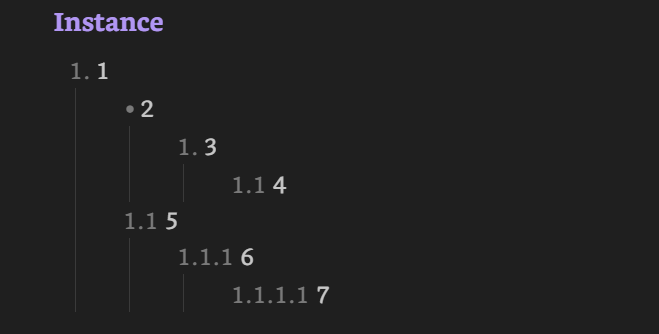

# Smart Order List

Smart Order List maintains ordered and nested list prefixes as you edit in Obsidian. It supports numbers, letters, Chinese numerals, bullets, and task checkboxes.



## 1. Insight

> the *Line*: exclusive to the lines of which the **meta-component** is *list*

**1. Element's consecution** is Parallel (cross Line) and Nested (cross Nest) from Upper-Level Line. Check *Consecution Principle*.

- **Parallel Principle** (same-layer nest):
	- Parallel lists apply **self-consistent consecution** with each other in default.
- **Nest Principle**:
	- $\text{Nest-Layer} = \{\text{root}, \text{parent}, \text{child}\}$
	- $\text{Nest-Status} = \{\text{non-nested}, \text{nested}\}$
	- $\text{Nests-Relationship} = \{\text{parallel}, \text{crossed}\}$

**2. Passive behavior**

- Single `Enter` to new line for consecution.
- Append `Space` to activate prefix.
- `Tab` to nest.

**3. Proactive behavior**

- Repeatedly `Enter` to strip prefix gradually.
- Edit *elements* to manually initialize prefix.
- Insert `\` as escape char before element separator `.`.

## 2. Features

- Continue and adjust list prefixes with `Enter`, `Space`, and `Tab`.
- Combine numeric and alphabetic elements in nested ordered prefixes.
- Use task checkboxes with ordered prefixes, including inside plain blockquotes.
- Choose between fixed and dynamic Reading-view indentation.

## 3. Quick start

1. Type `1.` followed by `Space`, then enter an item.
2. Press `Enter` to start the next item.
3. Press `Tab` on a list item to nest it, or `Shift`+`Tab` to move it back.

For example, indenting the second item produces a nested prefix:

```text
1. Parent
    1.1 Child
```

## 4. Element table

An **Element** is the smallest component of a **Prefix-Part**: for example, `1` and `2` are Elements in `1.2`. The table summarizes the supported elements and their properties.

| element_id | element_name   | description(&sample)                                                                                  | range                                                                                                                                                 | type_primary | type_secondary | variation     | slot_max | mix_part | mix_mixture |
| ---------- | -------------- | ----------------------------------------------------------------------------------------------------- | ----------------------------------------------------------------------------------------------------------------------------------------------------- | ------------ | -------------- | ------------- | -------- | -------- | ----------- |
| 1          | **Numeral.1**  | classic #hotkey ,  <br>1. `1.` <br>2. `1.1`  <br>3. `1.1.1` <br>4. `1.1.1.1`                          | non-negative-Int<br><br>`1`: *Initial Shuffle Mechanism*, <br>`0`: the manual introduction | ordered      | Numeral        | classic       | 4        | T        | T           |
| 2          | **Numeral.2**  | parenthesized, <br>1. `(1)` <br>*Nested Prefix Fallback Mechanism* | parenthesized positive-Int                                                                                                                            | ordered      | Numeral        | parenthesized | 1        | F        | T           |
| 3          | **Alphabet.1** | uppercase, <br>1. `A.` <br>2. `A.A` <br>3. `A.A.A` <br>4. `A.A.A.A`                                   | A~Z                                                                                                                                                   | ordered      | Alphabet       | uppercase     | 4        | T        | T           |
| 4          | **Alphabet.2** | lowercase, <br>1. `a.` <br>2. `a.a` <br>3. `a.a.a` <br>4. `a.a.a.a`                                   | a~z                                                                                                                                                   | ordered      | Alphabet       | lowercase     | 4        | T        | T           |
| 5          | **Chinese.1**  | classic<br>1. `一、` <br>*Nested Prefix Fallback Mechanism*          | 一~一百                                                                                                                                                  | ordered      | Chinese        | classic       | 1        | F        | T           |
| 6          | **Bullet**     | bullet  #hotkey <br>1. `- `                                                                           | -                                                                                                                                                     | unordered    | Bullet         | classic       | null     | F        | F           |
| 7          | **Checkbox**   | checkbox #hotkey <br>1. `- [ ]` <br>2. `- [-]` <br>3. `- [x]`                                         | -                                                                                                                                                     | unordered    | Checkbox       | classic       | null     | F        | T           |

**T** means true, and **F** means false. `slot_max` is the maximum number of slots in a prefix-part; `mix_part` indicates whether the element can occur in a multi-slot ordered prefix-part; `mix_mixture` indicates whether it can participate in a checkbox and ordered-list mixture. Numeric values are limited to JavaScript's largest safe integer, `9,007,199,254,740,991`. Manually introduced `0` is supported in all-numeric prefix-parts, subject to the ordering rules.

Numeric and alphabetic elements can form ordered prefixes with up to four slots when the nesting rules allow. A single numeric or alphabetic element ends with a dot, such as `1.` or `a.`. In a multi-slot prefix, dots go only between elements: use `1.2`, not `1.2.`.

When a recognized ordered prefix exceeds its supported range or nesting rules, it can fall back to a bullet while retaining the line's indentation and content. For example, the item after `z.` falls back to a bullet.

## 5. Indentation profiles

Choose a profile under **Settings → Smart Order List → Indentation Profile**:

| Profile | Live Preview | Reading view |
| --- | --- | --- |
| **Profile 1** (default) | Fixed indentation | Fixed indentation |
| **Profile 2** | Fixed indentation | Dynamic indentation based on parent prefixes |

## 6. List shortcuts

> [!TIP]
> **Advice**
>
> You could assign hotkeys in advance for better use of the plugin (Obsidian native feature) 
>
> **1. Assign `hotkey`**
>
> - Path: Obsidian Settings > Hotkeys >
>   1. *Toggle bullet list*: (Bullet Line) E.g., `Ctrl`+`.`
>   2. *Toggle numbered list*: (Numeral.1 Line) E.g., `Ctrl`+`Numpad1`
>   3. *Toggle checkbox status*: (Checkbox Line) E.g., `Ctrl`+`L`
>
> **2. Tips**
>
> - Manual shuffle helps to relieve disorder e.g., Bullet `hotkey`

## 7. Known limitation

Nested lists inside callouts can still be misaligned in Live Preview.

## 8. Installation

See the [release page](https://github.com/Howe-Ren/smart-order-list/releases) for installation instructions and downloadable plugin files.

## 9. License

[Apache License 2.0](LICENSE)
